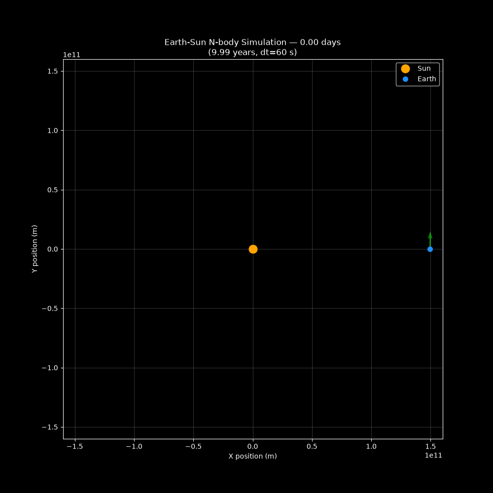
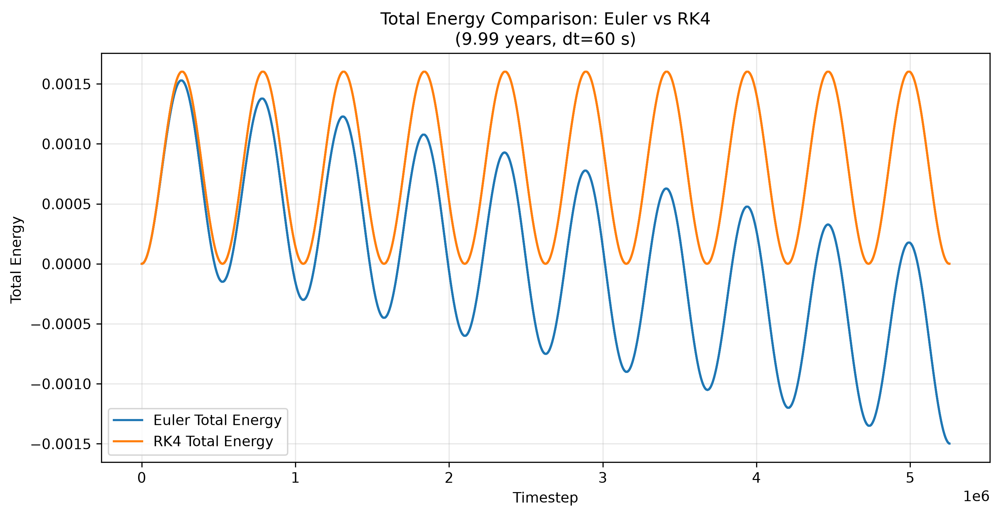
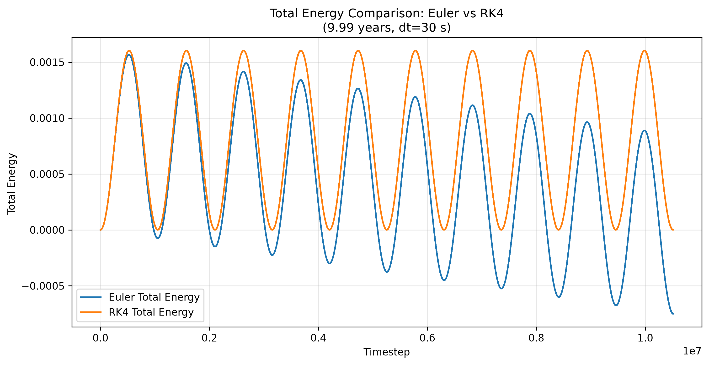

# N-body Gravitational Simulation (C++)

A simple two-body gravitational simulation written in C++ that models the Earth–Sun system using Newtonian gravity.

The project implements and compares two numerical integration methods:

- Forward Euler: A first-order explicit integration method.
- Runge-Kutta 4 (RK4): A fourth-order integration method using four derivative evaluations per time step.

## Implementation

The simulation calculates the mutual gravitational acceleration between two bodies and evolves their positions and velocities over time.

The implementation uses C++ structs and vectors to represent the bodies and their physical properties. Simulation results are exported to CSV for analysis and visualisation using Python.

  

## Results and Numerical Comparison

The integration methods were compared over ten orbital periods, examining:

- Orbital trajectories.
- Positional differences between integration methods.
- Conservation of total mechanical energy.
- Sensitivity to timestep size.

At a timestep of 60 seconds, both methods produced comparable orbital trajectories. However, differences were more apparent when examining total mechanical energy.

Forward Euler exhibited greater energy drift over time, while RK4 maintained significantly better energy conservation. Reducing the timestep improved the energy behaviour of both methods, demonstrating the influence of timestep size on numerical accuracy.

  
  

These results show the trade-off between computational simplicity and numerical accuracy when choosing an integration method.

## Technologies

* C++
* Python
* NumPy
* Matplotlib

## Running the simulation

Compile using a C++ compiler:

g++ -O2 -std=c++17 main.cpp -o nbody
./nbody

Simulation results are written to a CSV for later analysis.

